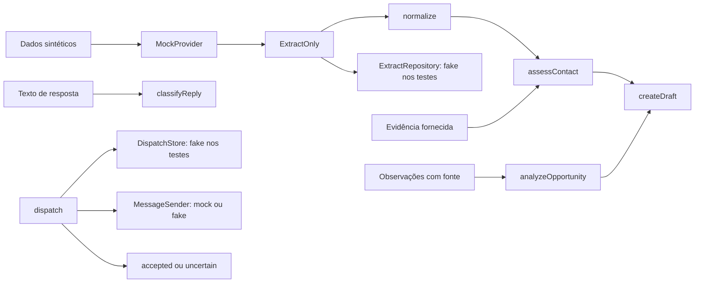

# Hearts

**Núcleo de prospecção com decisões rastreáveis, revisão humana e tratamento explícito de falhas.**

Este repositório apresenta uma extração executável do Hearts, projeto desenvolvido no contexto da Neovian. O recorte concentra as regras que podem ser avaliadas localmente: normalizar empresas, organizar uma execução de coleta, avaliar evidência de contato, formular uma hipótese de oferta e preparar um rascunho para revisão.

A implementação é TypeScript com interfaces para coleta e persistência. A versão pública roda com dados sintéticos e componentes em memória, sem banco ou credenciais. Os adapters de infraestrutura do projeto original não integram este repositório. O [status](STATUS.md) distingue o que esta cópia demonstra dos limites do produto original.

## O problema

Uma empresa encontrada em uma busca ainda não é um contato comercial validado. Um número com formato correto pode pertencer a outra unidade, uma hipótese de oferta pode não ter evidência e uma tentativa de envio pode terminar sem confirmação.

O Hearts torna essas diferenças explícitas no código. A normalização preserva incerteza; a avaliação registra as evidências usadas; o rascunho depende da qualidade do contato; e uma falha de despacho vira `uncertain`, sem retry automático.

## Decisões de implementação

- **Não inferir DDI.** Um telefone fora do formato E.164 permanece indefinido na representação normalizada. O payload original é preservado.
- **Separar descoberta de decisão.** `ExtractOnly` coordena paginação, persistência e resumo; regras de contato e oferta ficam em funções independentes.
- **Reexecutar sem recoletar quando o repositório informa conclusão anterior.** O contrato devolve o resumo com `replayed: true`. Nos testes, isso é demonstrado por um repositório fake; a deduplicação PostgreSQL do original está fora deste recorte.
- **Exigir evidência para contato verificado.** O domínio oficial, a unidade e os números informados são comparados. Evidências conflitantes resultam em `ambiguous`.
- **Manter a oferta como hipótese.** Sem observação com fonte, a classificação é exploratória e a confiança é zero. A pontuação é uma regra determinística, não uma probabilidade calibrada.
- **Priorizar opt-out.** A classificação de resposta verifica pedidos de interrupção antes de sinais comerciais.
- **Persistir incerteza de despacho.** A orquestração exige um identificador de confirmação e registra falhas sem repetir a tentativa. O store de aprovação/claim é uma interface, não uma implementação persistente nesta cópia.

## Executar

Requer Node.js 22 ou superior e npm.

```sh
npm ci --ignore-scripts
npm run typecheck
npm test
npm run demo
```

A instalação obtém apenas dependências de desenvolvimento do registro npm. Os comandos de teste e demo não usam rede, banco, variáveis de ambiente ou serviços externos.

A demo mostra o mesmo contato antes e depois de receber evidência sintética, a oferta sugerida, um rascunho e exemplos de classificação de resposta. Os números e domínios usados são de demonstração. Não representam empresas ou destinatários reais.

## Arquitetura deste recorte



As duas interfaces de persistência são pontos de integração. Este repositório não implementa o store de produção. Veja o [mapa de arquitetura](docs/ARCHITECTURE.md) para os contratos e a diferença entre o subset e o sistema de origem.

## O que os testes verificam

| Área | Comportamento coberto |
|---|---|
| Extração | Normalização, resumo, falha parcial, replay e rejeição de conta/modo inválidos |
| Contato | Número provável, evidência de domínio oficial, conflito, ausência e formato inválido |
| Oferta e rascunho | Hipótese exploratória sem evidência; texto limitado a 350 caracteres e uma pergunta |
| Resposta | Opt-out tem prioridade sobre interesse; respostas incertas vão para revisão |
| Despacho | Erro do sender resulta em `uncertain`, com uma única tentativa |

As regras de decisão são determinísticas. Não há modelo de linguagem, taxa de conversão alegada ou validação de entrega externa nesta versão.

## Navegação

```text
src/
  contracts.ts    Tipos, validação da entrada e hash
  normalize.ts    Normalização conservadora de empresas
  providers.ts    Provider em memória
  extract.ts      Coordenação de coleta e resumo
  journey.ts      Contato, hipótese, rascunho e resposta
  dispatch.ts     Orquestração de despacho injetável
tests/           Testes offline extraídos do projeto
examples/        Demo de regras com dados sintéticos
docs/            Arquitetura e rastreabilidade da extração
```

## Autoria e uso

Projeto apresentado por [Enzo Sousa](https://github.com/ogsousa). A lista de arquivos extraídos e adaptações está em [EXTRACTION.md](docs/EXTRACTION.md). O código está disponível para leitura e avaliação técnica, com [direitos reservados](RIGHTS.md); não foi atribuída licença open source.
