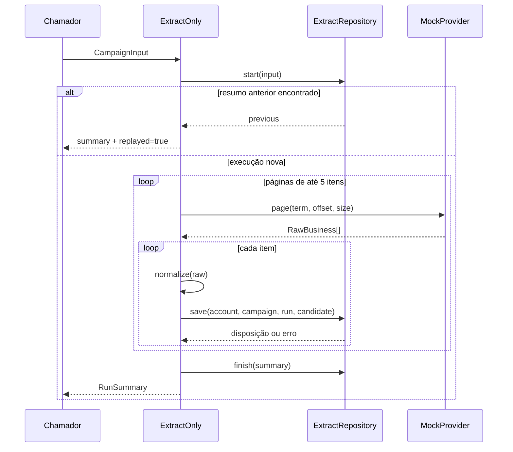
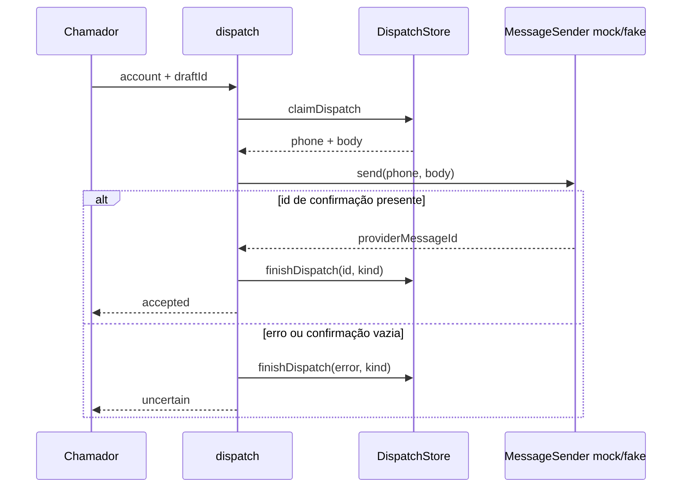

# Arquitetura

O recorte público mantém dois fluxos independentes e funções de decisão compartilháveis. Ele não encadeia automaticamente coleta, aprovação e envio.

## Extração

`ExtractOnly` depende de `Provider` e `ExtractRepository`. A entrada exige UUID de conta, chaves de campanha/execução, termo, limite e modo `extract_only`. O coordenador usa páginas de até cinco itens, normaliza cada empresa e delega a gravação ao repositório.

O retorno de `save` classifica o item como criado, encontrado ou pendente de revisão; `ExtractOnly` apenas contabiliza essas decisões. O algoritmo de matching não está dentro do coordenador. Falhas individuais entram no resumo, mantêm itens anteriores e tornam a execução `failed`. Uma execução concluída anteriormente pode ser devolvida pelo repositório, evitando nova chamada ao provider.

Nos testes, `FakeRepository` acumula candidatos em memória e registra um resumo. Ele deliberadamente não substitui a persistência transacional, o matching por conta ou os locks do sistema original.

## Regras de decisão

`assessContact` diferencia formato, evidência de propriedade e conflito entre números. `analyzeOpportunity` escolhe uma hipótese pela primeira observação válida, preserva as fontes e registra o que ainda é desconhecido. `createDraft` limita o texto a 350 caracteres e uma pergunta; a condição `readyForReview` depende de contato verificado pela regra. `classifyReply` prioriza bloqueio/opt-out antes das categorias comerciais.

Essas funções não consultam websites, CRM ou modelos de linguagem. Toda evidência é um argumento da função e deve ser validada pelo sistema que a fornece.

## Despacho

O contrato pressupõe que o store controla aprovação e exclusividade do claim. A cópia não fornece um store persistente. A orquestração não realiza retry automático; se a gravação do resultado também falhar, o erro pode propagar ao chamador e exigir reconciliação.

## Fronteiras da extração

O sistema de origem também contém PostgreSQL, inspeção de site, HTTP de coleta, mensageria, inbound e projeção para CRM. Esses componentes foram excluídos deste pacote. Os tipos preservam nomes de providers do contrato original, mas não há implementação de rede associada a eles nesta versão.
